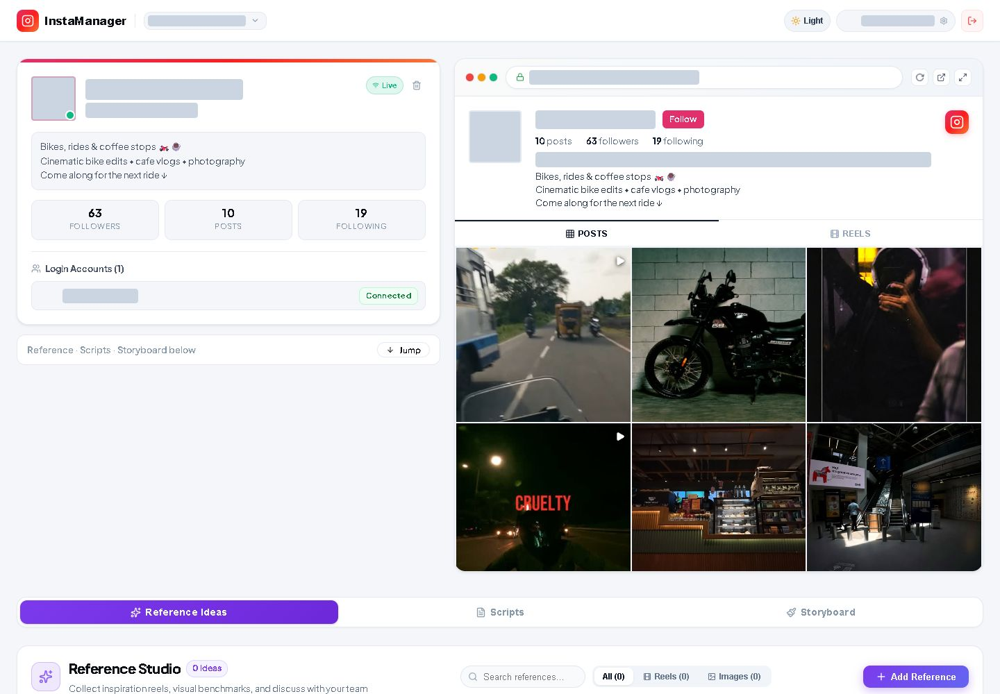
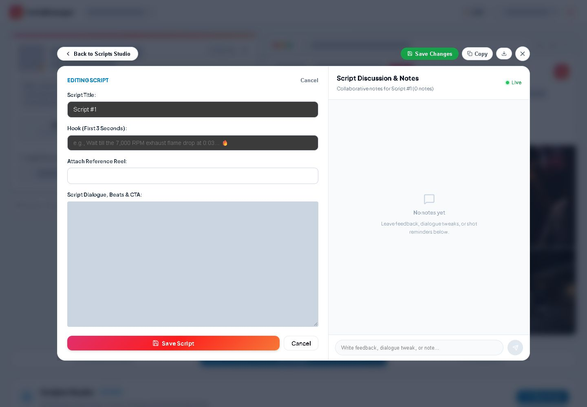
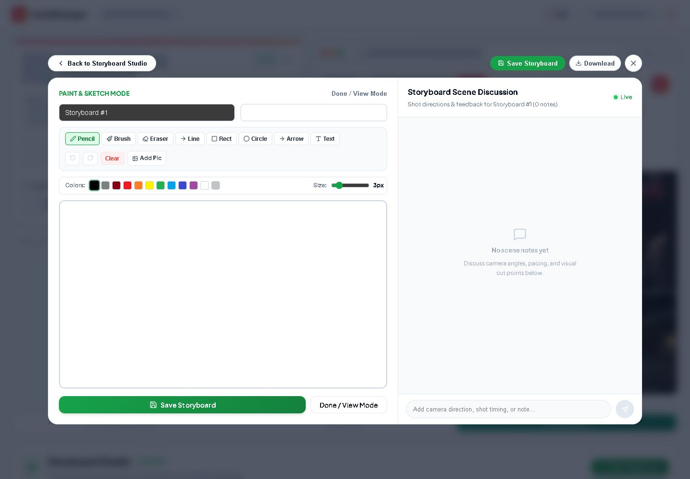

# Documentation repository

This private repository contains reviewed project documentation, screenshots with identifying details masked, and the final development SQL schema. Application source and account sessions are kept in the local application checkout. Setup and architecture guides refer to that checkout.

---

# InstaManager — Content Creation Workspace

An Instagram content planning workspace for creators and teams, previously documented as InstaCreator OS. Organize account workspaces, collect references, draft reel scripts, and sketch storyboards in one interface.

Built with React 19, Vite 8, Supabase, Express 5, and an HTML canvas drawing editor. This is currently a local development application; see [deployment limitations](docs/SETUP.md#deployment) before exposing it publicly.



## Features

- **Account workspaces:** create and switch Instagram projects, inspect profile information, and view attached creator profiles.
- **Reference Ideas:** save reel/post URLs or image references, search and sort the library, add reactions, and discuss creative angles.
- **Scripts Studio:** draft titles, hooks, dialogue, and visual beats; attach a saved reference or external reel; discuss scripts; copy or export plain text. Existing scripts open in view mode before editing.
- **Storyboard Studio:** pencil, brush, eraser, lines, shapes, arrows, and text; colors and stroke sizes; undo/redo; image import; saved boards and PNG downloads.
- **Instagram profile panel:** refresh profile information and browse Posts/Reels in a browser-style panel. Retrieval uses scraping, cached data, and fallbacks rather than the official Instagram Graph API.
- **Profile and theme settings:** creator identity settings, light/dark themes, and responsive layouts. The desktop browser panel is hidden on phone layouts.
- **Admin portal:** a separate `/admin` screen for activity, engagement, presence, and account access settings.
- **Persistence:** Supabase integration with browser-local fallback storage. References, scripts, and storyboards are currently shared libraries across account workspaces.

## Quick start

Prerequisites: Node.js **20.19+ or 22.12+** (Node 24 was used for verification), npm, and Google Chrome for backend scraping/browser features. Chrome is currently expected at `C:\Program Files\Google\Chrome\Application\chrome.exe`.

```bash
npm ci
```

Copy `.env.example` to `.env` and set your own Supabase URL and publishable key. On PowerShell:

```powershell
Copy-Item .env.example .env
```

Review [database setup](docs/SETUP.md#supabase) before running `supabase/schema.sql` on a disposable development database. Then start both services:

```bash
npm run dev
```

- Frontend: <http://localhost:5173>
- Backend health check: <http://localhost:5000/api/health>
- Admin portal: <http://localhost:5173/admin>

The login screen supports sign-in and sign-up. The current implementation can create a local user session when Supabase authentication fails, so this is a development convenience rather than a secure access boundary.

## Screenshots

These captures use the original signed-in account workspace. Account handles, login names, personal display names, and profile avatars are masked with opaque blocks. The account's creative libraries were empty at capture time; the editors show unsaved drafts. No sample content was inserted.

| Scripts Studio | Storyboard Studio |
| --- | --- |
|  |  |

See the [full screenshot gallery](docs/SCREENSHOTS.md) for all nine images, including login, original libraries, dark appearance, and phone layout.

## Final SQL schema

Include [`supabase/schema.sql`](supabase/schema.sql) on GitHub. It contains all 13 tables, compatibility migrations, policies, Realtime setup, and auth-profile synchronization, with no personal account records or credential seed. The [schema guide](supabase/README.md) explains setup and its development-only access policies. This file was prepared locally and has not been applied to the live database.

## Documentation

| Guide | Contents |
| --- | --- |
| [Setup and operations](docs/SETUP.md) | Environment, database, commands, troubleshooting, deployment |
| [Architecture](docs/ARCHITECTURE.md) | Components, data flow, storage, schema, limitations |
| [User guide](docs/USER_GUIDE.md) | Account, reference, script, and storyboard workflows |
| [Backend API](docs/API.md) | HTTP routes and browser stream protocol |
| [Screenshot gallery](docs/SCREENSHOTS.md) | GitHub-ready PNGs and capture command |
| [GitHub preparation](docs/GITHUB.md) | Files to include, exclusions, verification, upload steps |

## Development commands

| Command | Purpose |
| --- | --- |
| `npm run dev` | Start Express and Vite together |
| `npm run dev:client` | Start only the frontend |
| `npm run dev:server` | Start only the backend |
| `npm run build` | Build the frontend into `dist/` |
| `npm run preview` | Preview the built frontend; does not start the backend |
| `npm run lint` | Run Oxlint |
| `node scripts/capture-docs-screenshots.js` | Generate separate demo-only test captures; does not replace the original gallery |

There is no `npm test` script. Existing `scripts/test-*.js` files are manual integration utilities; some contain fixed accounts, ports, or mutations. Review each before running it against a connected database.

## Verification

Documentation and screenshots were prepared on **14 October 2026**:

- Production build succeeded, with Vite's warning about a JavaScript chunk exceeding 500 kB.
- Final direct Oxlint invocation completed with **0 errors and 135 warnings** after local browser/test artifacts were excluded. `npm run lint` fails in this Windows workspace because the npm executable wrapper mishandles `&` in its directory name; the [setup guide](docs/SETUP.md#troubleshooting) includes a workaround.
- The final gallery uses the user-provided signed-in session and actual profile/post retrieval. It shows current empty creative libraries and unsaved editor states. Screenshots do not validate cloud writes or the final SQL execution.

No license file is currently included. Choose a license before presenting the project as open source.

