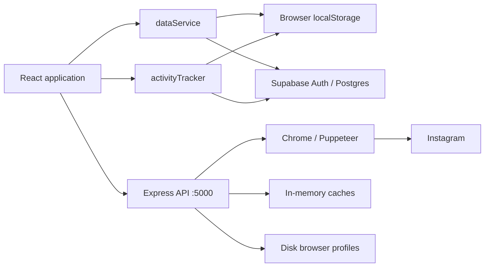

# Architecture

## System overview

The frontend connects directly to Supabase. Express provides Instagram parsing, scraping, proxying, and browser utilities; it is not a general CRUD gateway for creative documents.

## Source map

| Path | Responsibility |
| --- | --- |
| `src/main.jsx` | React entry point and styles |
| `src/App.jsx` | Auth gate, projects, hash navigation, admin route |
| `src/context/AuthContext.jsx` | Supabase auth, local user, fallback login/signup, profile updates |
| `src/context/ThemeContext.jsx` | Theme state and local/cloud preference |
| `src/components/ProjectList.jsx` | Account workspace cards |
| `src/components/CreateProjectModal.jsx` | Account creation and profile lookup |
| `src/components/ProjectDashboard.jsx` | Account summary, profile refresh, studio tabs |
| `src/components/LiveBrowserBox.jsx` | Browser-style profile panel with Posts/Reels |
| `src/components/ReferenceIdeas.jsx` | References, reactions, and discussion |
| `src/components/ScriptsStudio.jsx` | Script library, view/edit modes, TXT export |
| `src/components/StoryboardStudio.jsx` | Canvas tools, history, boards, PNG export |
| `src/components/ReelPlayer.jsx`, `ReelModal.jsx` | Reference media display |
| `src/components/ProfileSettingsPage.jsx` | User settings |
| `src/components/AdminPortal.jsx` | Admin login and four admin views |
| `src/services/dataService.js` | Local data, Supabase queries/mutations, normalization/merging |
| `src/services/activityTracker.js` | Presence, actions, engagement, permissions, admin sessions |
| `src/services/seedData.js` | Default accounts and empty creative seed arrays |
| `server/server.js` | HTTP endpoints, scraping and caches |
| `server/browserManager.js` | Persistent Chrome profiles and WebSocket screencast/input |
| `supabase/schema.sql` | Final tables, compatibility migrations, policies, auth sync, publications; no credential seed |
| `scripts/` | Launcher and manual verification/capture utilities |

## Navigation

- `/`: login or authenticated project list.
- `#workflow-studios/<handle>`: account dashboard.
- `#workflow-studios/<handle>/scripts` and `/storyboard`: supported initial studio selections.
- `#profile-settings`: creator settings.
- `/admin`, `#admin`, or `#/admin`: admin portal outside the usual AuthProvider/ThemeProvider tree.

Studio buttons replace the URL with the base workspace hash; they do not preserve the studio suffix. An unknown handle in a workspace URL can trigger lookup and project creation.

## Persistence

Authentication checks `insta_app_user` then Supabase's session. Login/signup can fall back to a local identity on cloud failure. The theme uses `insta_theme_preference`.

Creative data uses `insta_creator_dashboard_data_v10`: projects, references/comments, scripts/comments, and storyboards/comments. Old versions 1–9 are removed at initialization. Default account workspaces are reintroduced when absent.

`dataService` reads cloud rows and falls back locally. References, scripts, and boards merge cloud and local records by ID. Their getters accept a project ID but currently return shared collections without project filtering. These are shared creative libraries, not isolated account data.

Writes generally update localStorage and attempt Supabase writes. Resolved results containing an `error` can be ignored. Local success does not establish cloud success; merging is not transactional or a conflict-resolution system.

`activityTracker` records actions, presence, and engagement with local fallback and cloud operations. The admin screen subscribes to Realtime. Account visibility is filtered client-side using stored permissions.

## Data model

| Table | Main data / logical association |
| --- | --- |
| `profiles` | Auth UUID, email, name, avatar, theme |
| `projects` | Account handle, profile metadata, browser state |
| `reference_ideas` | Project ID, referrer, media, title, hook notes, reactions |
| `idea_comments` | Idea ID, user, comment, pitch |
| `scripts` | Project ID, author, title, hook/body, reference/custom URL |
| `script_comments` | Script ID, user, comment |
| `storyboards` | Project ID, author, title, PNG data URL, reference |
| `storyboard_comments` | Board ID, user, scene notes |
| `admin_users` | Admin identity and plaintext password |
| `user_permissions` | Account access choices |
| `user_presence` | Status, page, device, heartbeat |
| `activity_logs` | Recorded actions |
| `engagement_metrics` | Time and engagement measurements |

Project/reference/comment associations are often text IDs without foreign keys. Auth-linked profiles and some author IDs reference `auth.users`. Consult the SQL for exact definitions.

Canvas state is a PNG data URL, including undo/redo snapshots. Large boards can consume significant memory and browser storage quota.

The phone capture shows horizontal clipping in the account summary for a long workspace name. The browser panel is hidden as intended, but the account card still needs responsive sizing work at narrow widths.

## Instagram and browser behavior

The visible `LiveBrowserBox` fetches metadata and renders its own profile interface, rather than streaming interactive Chrome. It and the dashboard each refresh on 10-second intervals.

The backend separately implements Chrome profiles under `browser-sessions/<handle>_<section>/`, a `/browser-stream` WebSocket, frame proxying, and Chrome launch. These backend capabilities differ from the visible dashboard panel.

Retrieval can use scraped, cached, and known-account fallback data. Cached media URLs may expire. `/api/instagram/live-metrics` echoes a supplied follower count; project telemetry returns fixed sample metrics. Neither establishes live Instagram analytics.

## Access boundaries

The current source uses local auth fallback, client-side admin checks, permissive SQL policies, and broadly accessible backend endpoints. Hiding `/admin` from navigation does not protect it. See [deployment guidance](SETUP.md#deployment).
