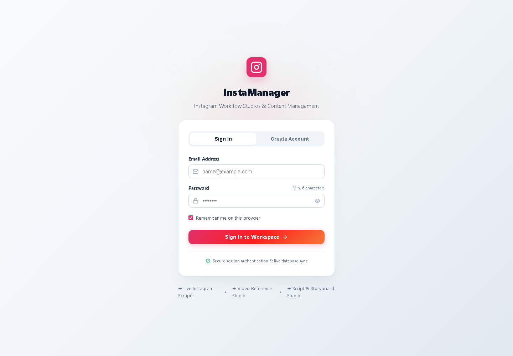
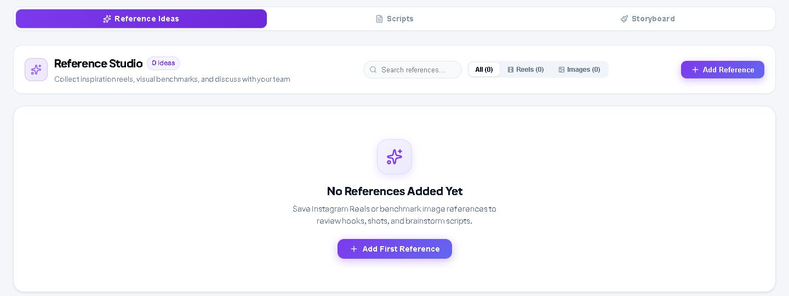
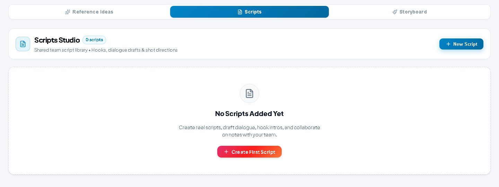
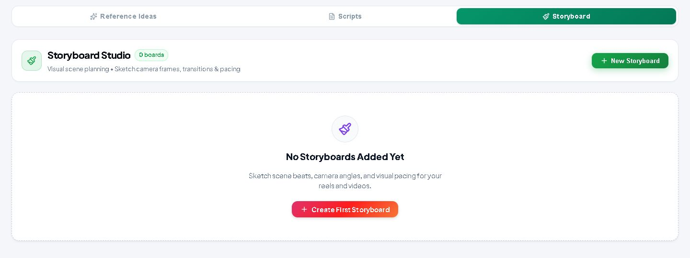
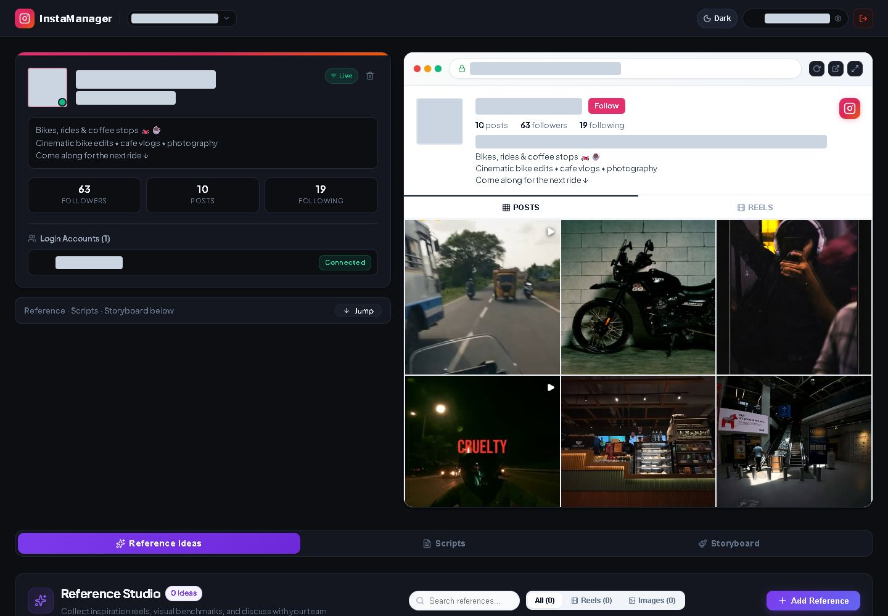
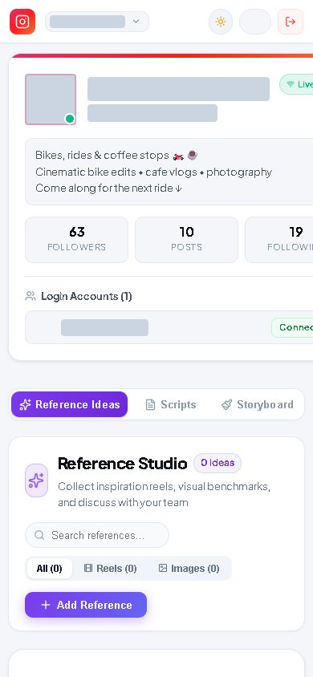

# Original screenshot gallery

Captured on **14 October 2026** from the user's signed-in application workspace. These are original UI captures, with no fixture profile or sample documents inserted. Account handles, email/login names, personal display names, and profile avatars are hidden with opaque masks before image capture. The blank login image was captured before sign-in and contains no entered credentials.

The original account profile and post grid were retrieved by the application. References, scripts, and boards were empty at capture time. Editor screenshots show the app's unsaved new-document screens; no creative document was saved or existing content changed. The script template body is masked because its default call to action includes an account handle.

Desktop/dashboard/editor captures use a 1440 × 1000 viewport, library images are cropped to their studio sections, and the phone image uses 390 × 844. JPEGs were captured through the browser; the blank login is PNG. Relative image paths render directly on GitHub.

## Login

## Account workspace

## Reference Ideas

## Scripts library

## Storyboard library

## Dark appearance

## Phone layout

The current account card clips at narrow widths; this image preserves that behavior rather than changing the app's layout for the screenshot.

## Script editor

## Paint editor

## Refresh original captures

1. Start the local app and sign in using your own credentials. Never commit credentials or session exports.
2. Add `?screenshotPrivacy=1` before the workspace hash in the local URL, retaining the selected workspace hash. This mode works only in Vite development.
3. Inspect the rendered screen to ensure account details and avatars are masked. The helper is presentation-only and does not sanitize stored records or HTML.
4. Capture the dashboard, libraries, and editor screens. Use unsaved drafts and close them without saving.
5. Review every image before replacing files under `docs/screenshots/`. Masking depends on the current UI; text inside post images must also be inspected.
6. Restore the original theme and viewport after capture.

Only publish the reviewed image files. The development masking helper leaves identifying data in the DOM and browser storage, so exporting HTML or browser state would still disclose it.

The isolated demo generator remains available as `node scripts/capture-docs-screenshots.js`, but it now writes to ignored `test-artifacts-docs-demo/`. Its fixtures are separate from this original gallery and cannot overwrite these images.
